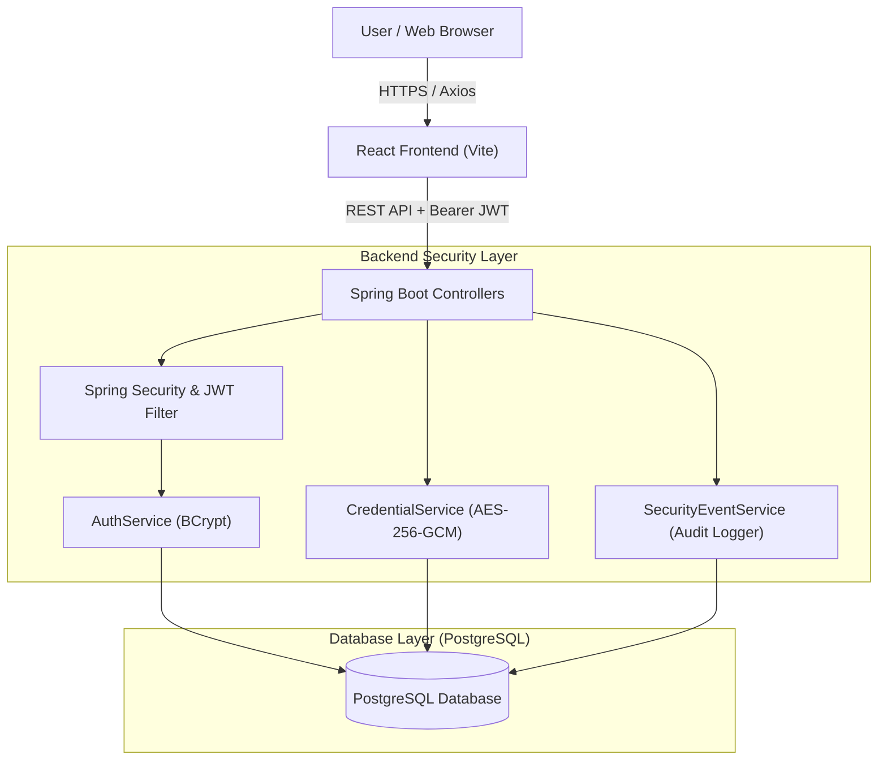

# SecureVault — Full-Stack Cybersecurity Credential & Password Platform

SecureVault is an enterprise-grade full-stack password and credential management platform engineered with modern security standards. It combines BCrypt password hashing, JWT authentication, AES-256-GCM vault encryption, temporary & granular credential sharing, collaborative team vaults, password generation & strength analysis, and real-time login activity audit monitoring.

---

## Architecture Diagram



---

## Features

- **Authentication & Security**:
  - Secure registration & login powered by **BCrypt** password hashing.
  - Stateless **JWT (JSON Web Token)** authentication with automatic Bearer token management.
  - Server-side ownership, permission level, and expiration enforcement.

- **AES-256 Vault Encryption**:
  - Vault passwords & sensitive notes encrypted using **AES-256-GCM** authenticated encryption.
  - Encryption keys stored strictly in backend configuration and never exposed to the frontend or REST APIs.

- **Credential Sharing & Permissions**:
  - Share credentials with other registered users by email.
  - Granular permissions: `VIEW_ONLY`, `EDIT_ACCESS`, `FULL_MANAGEMENT`.
  - Temporary sharing with automated backend timestamp expiration.
  - One-click access revocation.

- **Team Vaults**:
  - Create custom Team Vaults.
  - Manage team members and roles (`OWNER`, `ADMIN`, `MEMBER`).
  - Share credentials within specific teams.

- **Password Utilities**:
  - Configurable password generator (length, uppercase, lowercase, numbers, symbols).
  - Real-time password strength analyzer evaluating length, character diversity, and structure.

- **Login Activity & Audit Monitoring**:
  - Records every authentication attempt (successful or failed) with IP address, timestamp, device/browser details, and failure reasons.
  - Authenticated users can view their own login activity history.

---

## Technology Stack

### Backend
- **Java 21**
- **Spring Boot 3.2.5**
- **Spring Security**
- **Spring Data JPA / Hibernate**
- **BCrypt Password Encoder**
- **JJWT (`io.jsonwebtoken`)**
- **PostgreSQL Database**
- **Apache Maven**

### Frontend
- **React.js 18**
- **Vite**
- **React Router v6**
- **Axios**
- **Lucide React Icons**
- **Vanilla CSS (Dark Mode Security Theme)**

---

## Detailed Data Flow Example: Credential Creation

```
React Add Credential Form
       ↓
POST /api/vault/credentials (Headers: Authorization Bearer <JWT>)
       ↓
Spring Security: Validates JWT token & extracts User email
       ↓
CredentialController: Receives CredentialRequest
       ↓
CredentialService: Identifies authenticated User
       ↓
EncryptionService: Encrypts plain password & notes using AES-256-GCM
       ↓
PostgreSQL: Stores encrypted_password & encrypted_notes ciphertext
       ↓
CredentialService: Returns decrypted response to authorized user
```

---

## API Endpoints

### Authentication
- `POST /api/auth/register` — Register a new user
- `POST /api/auth/login` — Authenticate and receive JWT token

### User
- `GET /api/user/me` — Get current logged-in user profile

### Vault Credentials
- `POST /api/vault/credentials` — Create new encrypted credential
- `GET /api/vault/credentials` — Fetch user's credentials (decrypted for owner)
- `GET /api/vault/credentials/{id}` — Fetch single credential (authorized owner or shared user)
- `PUT /api/vault/credentials/{id}` — Update credential (requires ownership or edit access)
- `DELETE /api/vault/credentials/{id}` — Delete credential (requires ownership or full management)

### Sharing
- `POST /api/vault/credentials/{id}/share` — Share credential with user email & permission level
- `GET /api/vault/shared-with-me` — List active non-expired credentials shared with caller
- `DELETE /api/vault/credentials/{id}/share/{userId}` — Revoke shared access

### Team Vaults
- `POST /api/teams` — Create team
- `GET /api/teams` — List teams user belongs to
- `POST /api/teams/{teamId}/members` — Add member to team
- `GET /api/teams/{teamId}/members` — List team members
- `GET /api/teams/{teamId}/vault` — Get team credentials

### Password Utilities
- `POST /api/password/generate` — Generate password by configuration
- `POST /api/password/analyze` — Analyze password strength

### Security Audit
- `GET /api/security/login-history` — Fetch caller's login security events

---

## Setup & Running Instructions

### Prerequisites
1. **Java 21+**
2. **Node.js 18+ & npm**
3. **PostgreSQL** running locally on port `5432` with database `securevault_db`.

### 1. Database Setup
```bash
createdb securevault_db
psql -d securevault_db -c "CREATE USER postgres WITH PASSWORD 'postgres' SUPERUSER;"
```

### 2. Backend Setup
```bash
cd backend
mvn clean compile
mvn spring-boot:run
```
The backend starts on `http://localhost:8080`.

### 3. Frontend Setup
```bash
cd frontend
npm install
npm run dev
```
The frontend starts on `http://localhost:5173`.
